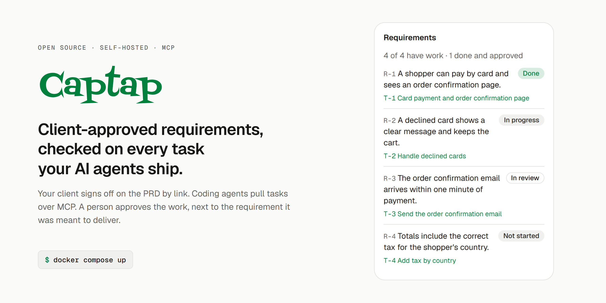
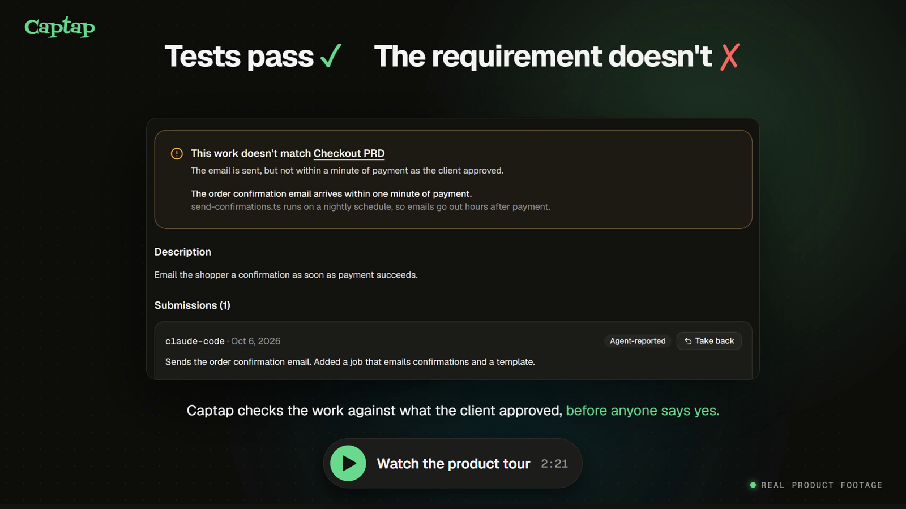
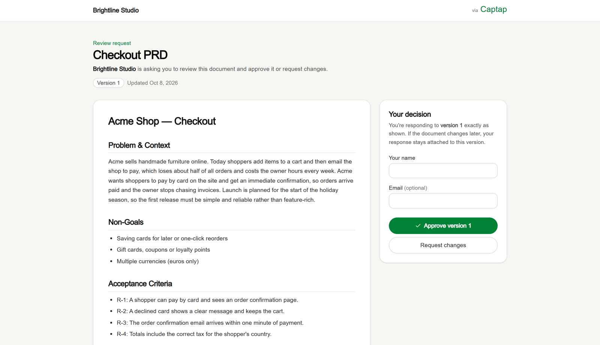
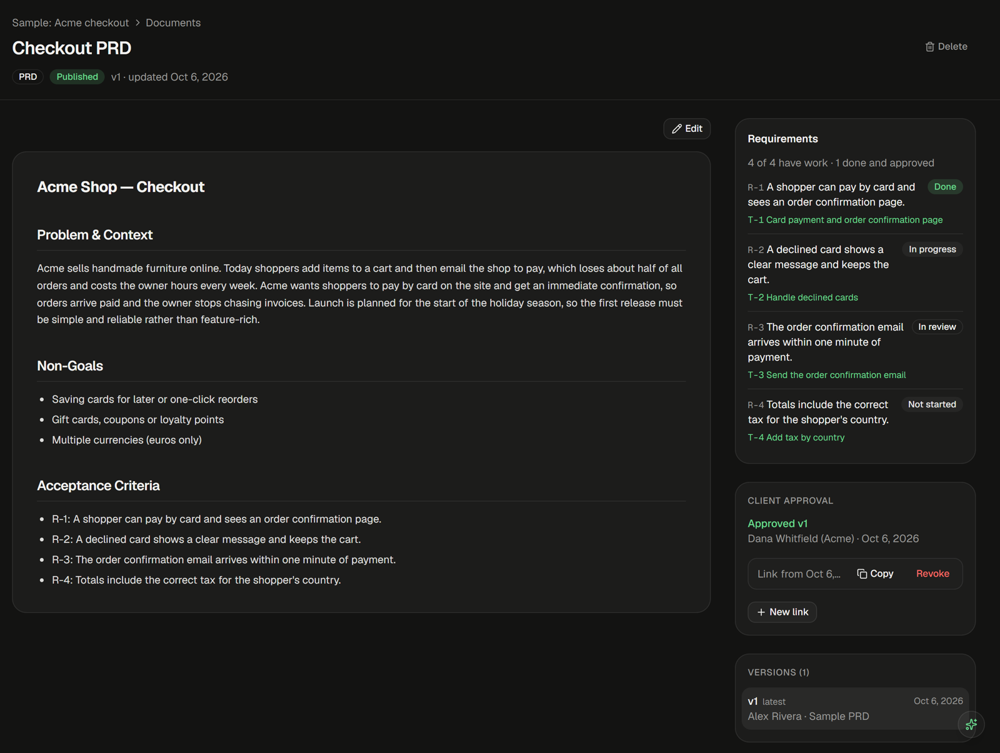
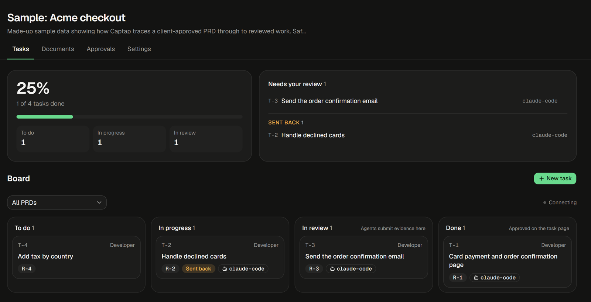
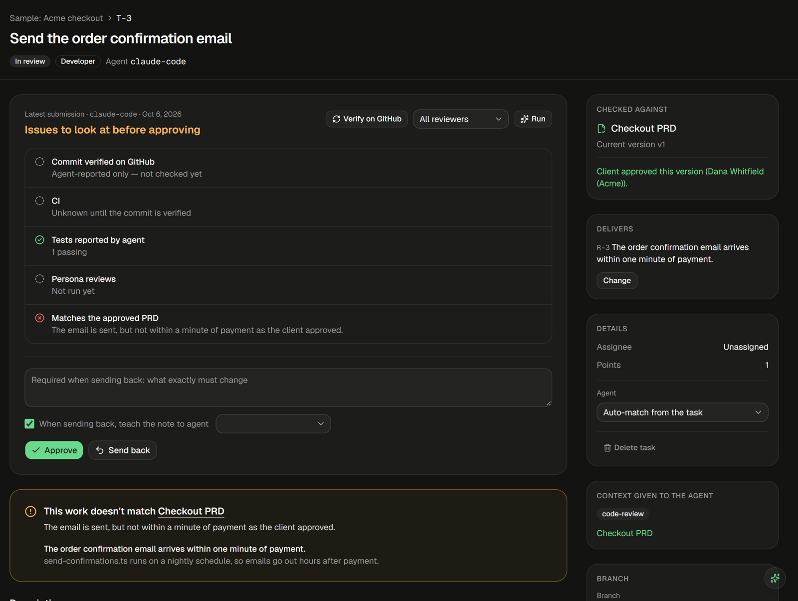

<p align="center">
  <picture>
    <source media="(prefers-color-scheme: dark)" srcset=".github/assets/banner-dark.png">
    <source media="(prefers-color-scheme: light)" srcset=".github/assets/banner-light.png">
    
  </picture>
</p>

<p align="center">
  <a href="LICENSE"></a>
  <a href="#connect-your-coding-agent"></a>
  <a href="#try-it-in-one-command"></a>
  
</p>

Agencies hand more and more client work to coding agents like Claude Code, Cursor and Codex. The agent
says it's done, the tests pass, and a week later the client asks why the confirmation email arrives the
next morning when they asked for "within a minute". Nothing connected what the client signed off on with
what the agent shipped.

Captap is that connection. The client approves the PRD by link. Every acceptance criterion becomes a
numbered requirement. Agents take tasks over [MCP](https://modelcontextprotocol.io) and hand back
evidence. A person approves the work, with the requirement it was meant to deliver right next to it.

<p align="center">
  <a href="https://pub-dea841f0968b4194b18176338ad6b2b5.r2.dev/captap/Captap-brand/captap-launch-full.mp4"></a>
</p>
<p align="center"><sub>Product tour, 2:21, with sound. Every screen in it is the real app.</sub></p>

## Try it in one command

You need [Docker](https://docs.docker.com/get-docker/). Nothing else: no accounts, no keys, no `.env`.

```bash
git clone https://github.com/jayanthmurala1-web/captap.git
cd captap
docker compose up
```

Open <http://localhost:3000>, create an account and a workspace, then click **Try a sample project**.
It opens a made-up client project with a signed-off PRD and one task where the agent's tests pass but
the work misses a requirement. That task is the whole idea in one screen.

The first start builds the image and takes a few minutes; after that it starts in seconds. Data lives in
a Docker volume, so it survives restarts (`docker compose down -v` wipes it). This setup is for trying
Captap on your own machine: it uses throwaway secrets and only listens on localhost. To run it for real,
see [Self-hosting](#self-hosting).

## How it works

**1. The client signs off on the PRD, by link.** No account for them. Their decision is pinned to the
exact version they read, and it's marked stale the moment the PRD changes. A PRD can't even be saved
without a real problem statement, at least two non-goals and acceptance criteria.

<p align="center"></p>

**2. Every acceptance criterion becomes a requirement: R-1, R-2, R-3.** Tasks link to the requirement
they deliver, so the PRD always shows which requirements have no work yet, which are in review and which
are done.

<p align="center"></p>

**3. Agents do the work over MCP.** An agent claims a task and gets everything it needs in one call:
the task, its requirements, your team's playbooks, rules learned from past send-backs, the relevant
documents and what it's waiting on. When it's done it submits evidence: files changed, tests run,
commit and branch. If the project's repository is linked, Captap checks that commit and its CI on GitHub
itself rather than taking the agent's word.

<p align="center"></p>

**4. Captap checks the work against what the client approved, and a person decides.** Passing tests
aren't the bar; the requirement is. Only a person can approve, never the one who submitted the work, and
agents have no approve or reject tool at all. Sending work back with a note can turn that note into a
rule the agents follow on similar tasks from then on.

<p align="center"></p>

## What's in it

**For your clients**
- Approval links that need no account, pinned to a version, with a stale warning when the PRD moves on
- A page per project showing every document you've shared and what the client decided

**For your agents** (MCP server at `/api/mcp`, OAuth sign-in, 58 tools)
- Full context per task in one call, then claim, submit evidence, release or take back a submission
- Read PRDs, requirements, architecture docs, playbooks and learned rules
- Plan work: create and assign tasks, manage documents, check project status
- No way to approve or reject anything. That stays with people.

**For your team**
- Workspaces, with roles you build from 13 permissions (Owner, Admin, Lead, QA and Product are only
  defaults), invitations, and clean removal that returns a person's claimed work to the pool
- Org Flow: decide which agent playbook handles product, developer, QA and DevOps tasks
- Consult: ask a specific agent a question, answered from that agent's playbook and your team's rules
- An agent marketplace to adopt playbooks other teams published, or publish your own
- Slack, GitHub and any MCP server as connections; signed webhooks you can edit, pause and test
- An append-only activity log, rate limits, and email for invites and decisions

## Connect your coding agent

Point any MCP client at your instance's `/api/mcp`. The first time, you sign in and approve the connection
on a consent screen. With Claude Code:

```bash
claude mcp add --transport http captap http://localhost:3000/api/mcp
```

Swap in your own address when you deploy it.

## Self-hosting

Captap is open source under the AGPL, so you can run it yourself, for your agency or anyone else.
Without Docker you need Node 20+, [pnpm](https://pnpm.io) and a Postgres database (a free
[Neon](https://neon.tech) project works).

```bash
git clone https://github.com/jayanthmurala1-web/captap.git && cd captap
pnpm install
cp .env.example .env     # fill it in; every variable is explained inside
pnpm db:migrate
pnpm build && pnpm start # or `pnpm dev` while developing
```

Only three settings are required: `DATABASE_URL`, `BETTER_AUTH_SECRET` and `BETTER_AUTH_URL`. Everything
else is optional and switches on one feature:

| Setting | What it turns on |
|---|---|
| `GROQ_API_KEY` (or OpenAI, Anthropic, Google, xAI, Cohere) | AI features: Consult, automated reviews, the check against the PRD. Your key, set by whoever runs the instance; every workspace on it uses it. |
| `SECRETS_ENCRYPTION_KEY` | Saving Slack, GitHub and MCP connections (their secrets are encrypted with it) |
| `RESEND_API_KEY`, `EMAIL_FROM` | Email for invitations, task decisions and client decisions |
| `REQUIRE_EMAIL_VERIFICATION=1` | New accounts must confirm their email (needs email set up) |
| `GITHUB_TOKEN` | Verifying commits and CI on private repositories |
| `CLOUDINARY_*` | Image uploads in the document editor |

The full list, with how to generate each value, is in [`.env.example`](.env.example). Running it in
production: use strong secrets, serve it over HTTPS, keep the database private, and back up
`SECRETS_ENCRYPTION_KEY`. More in [SECURITY.md](SECURITY.md).

## What it doesn't do yet

Captap is a beta built by one person, and it's better to know the edges up front.

- Only Groq has been tested end to end. The other five AI providers are built in but stay off until
  someone verifies them with a real key (one command, see `.env.example`).
- Branch and worktree suggestions for agents are advisory. Captap never touches your repository, so it
  checks the commit and CI an agent reports, not where it worked.
- Task roles are fixed to product, developer, QA and DevOps.
- Saved GitHub-token and MCP-server connections are verified and stored, but only Slack is used by
  anything yet.
- No billing, SSO or two-factor sign-in. English only. Tested on Neon Postgres and Vercel.

## Development

```bash
GROQ_API_KEY= pnpm test   # an empty key skips the live AI tests
pnpm typecheck && pnpm lint
```

The tests run against a real database and create and delete their own rows, so point `DATABASE_URL` at a
throwaway database, never one you care about.

Next.js 16 (App Router), strict TypeScript, Postgres with Drizzle, Better Auth (organizations and MCP
OAuth), Tiptap, React Flow and Vitest. Domain logic lives in `src/lib`, and every permission check goes
through `src/lib/access.ts`. Design decisions are in [`agent/DECISIONS.md`](agent/DECISIONS.md) and each
feature has a short spec in [`agent/specs/`](agent/specs).

Contributions are welcome; [CONTRIBUTING.md](CONTRIBUTING.md) explains how. To report a security problem
privately, see [SECURITY.md](SECURITY.md).

## Who's behind it

Captap is built by **Jayanth Murala**, a full-stack developer and AI engineer.

- Website: [jayanthmurala.com](https://www.jayanthmurala.com)
- GitHub: [jayanthmurala1-web](https://github.com/jayanthmurala1-web) (open source) ·
  [Jayanthmurala](https://github.com/Jayanthmurala)
- LinkedIn: [Jayanth Murala](https://www.linkedin.com/in/jayanth-murala-0045b2281)
- X: [@jayanthmurala_](https://x.com/jayanthmurala_) · Threads: [@jayanthmurala](https://www.threads.com/@jayanthmurala) ·
  Instagram: [@jayanthmurala](https://www.instagram.com/jayanthmurala) · Reddit: [u/ExpertEye9853](https://www.reddit.com/user/ExpertEye9853/)
- Email: [hello@jayanthmurala.com](mailto:hello@jayanthmurala.com)

If you run Captap for your agency, or tried it and it didn't fit, I'd like to hear about it.

## License

[GNU AGPL v3](LICENSE). You can use, change and self-host Captap. If you run a changed version as a
service for others, you have to offer them its source code too.
